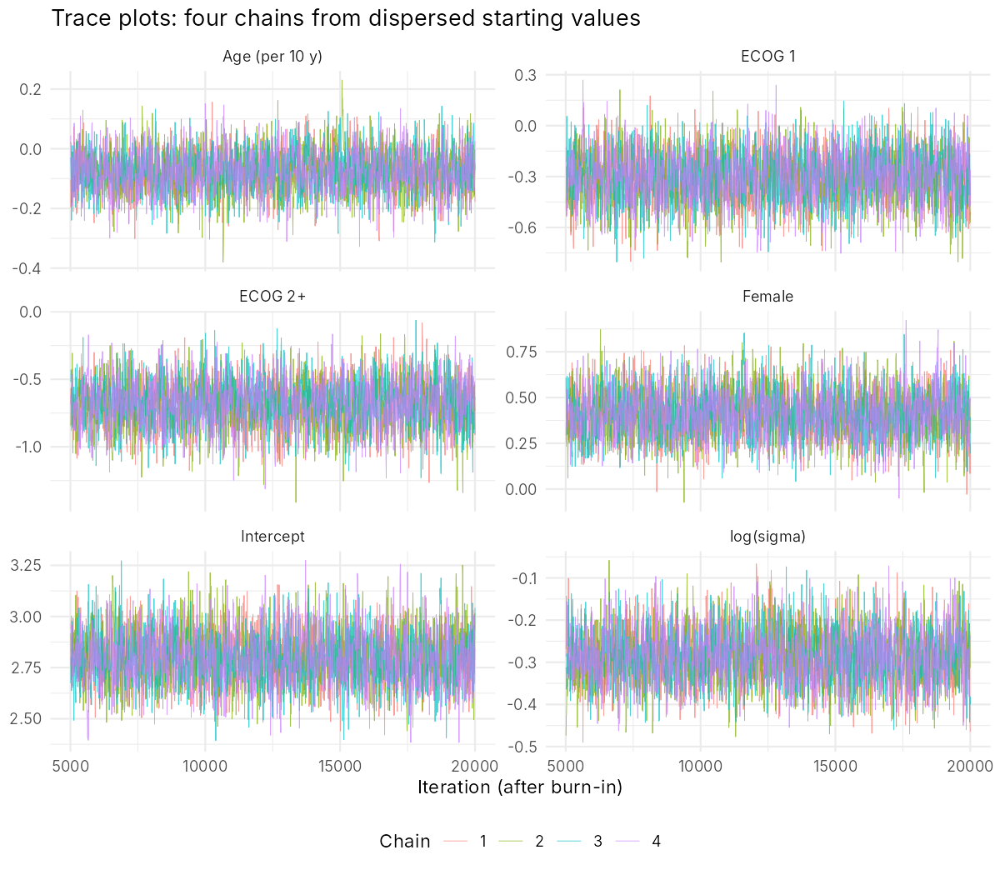
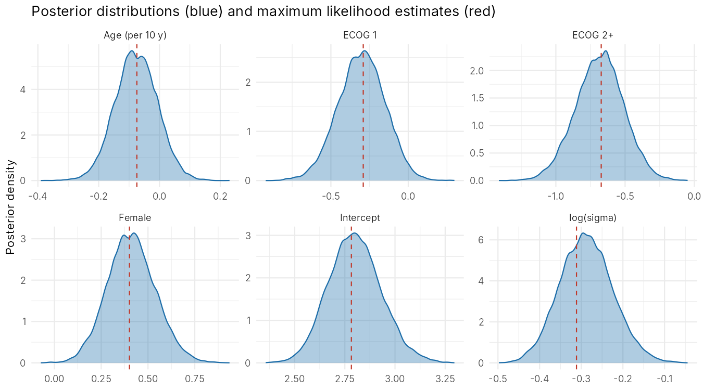
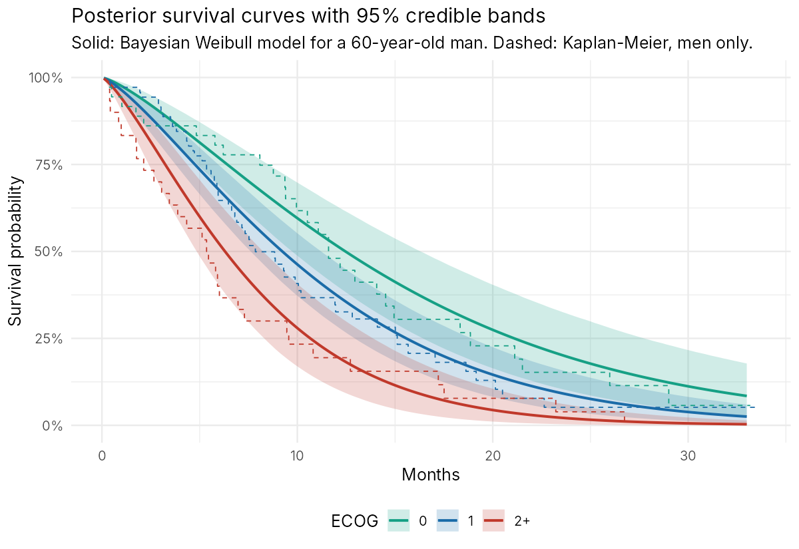

# Bayesian Weibull Survival Regression with a Metropolis Sampler Written from Scratch

This project fits a Bayesian Weibull accelerated failure time (AFT) model to right-censored survival data. The sampler is written by hand, without Stan or JAGS. It writes out the censored-data likelihood directly, builds a random-walk Metropolis sampler, checks convergence, and compares the results with maximum likelihood. Posterior draws then give survival curves and median survival times, each with full uncertainty.

## Question
In patients with advanced lung cancer, how are age, sex, and ECOG performance status related to survival time? And what is the expected survival time for different types of patients?

## Data
`lung` from the R `survival` package (North Central Cancer Treatment Group). The analysis uses 227 patients with complete data, of whom 164 died. The data are public and load inside R.

## Model
For patient *i* with survival time *T<sub>i</sub>*:

$$\log T_i = x_i^\top \beta + \sigma W_i, \qquad W_i \sim \text{standard minimum extreme value}$$

This is the Weibull model on the log-time scale, with shape parameter $1/\sigma$. With $z_i = (\log t_i - x_i^\top\beta)/\sigma$ and event indicator $\delta_i$, the log-likelihood is

$$\ell(\beta, \sigma) = \sum_i \Big[ \delta_i\big(-\log\sigma + z_i\big) - e^{z_i} \Big]$$

Deaths contribute the log density, and censored patients contribute the log survival function. The $-\log t_i$ term from the Jacobian is constant, so it is left out.

- **Covariates:** age (centred at 60, per 10 years), female sex, ECOG performance status (0, 1, 2+)
- **Priors:** $\beta_j \sim N(0, 10^2)$ (weakly informative), $\log\sigma \sim N(0, 2^2)$

## Sampler
- **Proposal:** random-walk Metropolis with a multivariate normal proposal. Its covariance is $(2.38^2/d) \cdot H^{-1}$, where $H$ is the Hessian of the negative log posterior at the mode (Roberts, Gelman & Gilks, 1997).
- **Chains:** 4 chains from dispersed starting values, 20,000 iterations each, with the first 5,000 discarded as burn-in.
- **Acceptance rate:** about 0.29 in every chain. The theoretical optimum for this dimension is about 0.23 to 0.3.

## Convergence

| Parameter | R-hat | Effective sample size |
|---|---:|---:|
| Intercept | 1.003 | 2,908 |
| Age | 1.001 | 3,094 |
| Female | 1.001 | 3,018 |
| ECOG 1 | 1.002 | 3,041 |
| ECOG 2+ | 1.002 | 2,994 |
| log(σ) | 1.001 | 2,877 |

Every R-hat is below 1.01, and the chains mix well.



## Results

**Posterior estimates agree closely with maximum likelihood.** This is expected with weak priors and n = 227, and it checks that the sampler is correct.



| Parameter | Posterior mean (95% CrI) | MLE (SE) |
|---|---|---|
| Age, per 10 years | -0.076 (-0.212, 0.060) | -0.074 (0.068) |
| Female | 0.412 (0.166, 0.672) | 0.401 (0.124) |
| ECOG 1 | -0.302 (-0.607, -0.014) | -0.291 (0.146) |
| ECOG 2+ | -0.684 (-1.032, -0.348) | -0.672 (0.167) |
| log(σ) | -0.288 (-0.409, -0.159) | -0.311 (0.061) |

**Time ratios** (exp(β)): a value above 1 means longer survival.

| Covariate | Time ratio (95% CrI) | Posterior P(time ratio > 1) |
|---|---|---:|
| Age, per 10 years | 0.93 (0.81, 1.06) | 0.13 |
| Female | 1.51 (1.18, 1.96) | 0.999 |
| ECOG 1 vs 0 | 0.74 (0.54, 0.99) | 0.02 |
| ECOG 2+ vs 0 | 0.50 (0.36, 0.71) | < 0.001 |

- Women survive about 1.5 times longer than men with the same age and ECOG status.
- Patients with ECOG 2+ survive about half as long as those with ECOG 0.
- The evidence for an age effect is weak once sex and ECOG are in the model.
- The posterior shape parameter, $1/\sigma \approx 1.33$, is above 1, so the risk of death rises over time.

**Posterior predictive survival curves** follow the Kaplan-Meier curves closely, which supports the Weibull assumption.



**Posterior median survival (months)** for a 60-year-old patient:

| ECOG | Men | Women |
|---|---|---|
| 0 | 12.5 (9.7, 16.3) | 18.8 (14.0, 26.0) |
| 1 | 9.2 (7.6, 11.2) | 13.9 (11.1, 17.8) |
| 2+ | 6.3 (4.8, 8.2) | 9.5 (7.2, 12.8) |

A real advantage of the Bayesian approach shows here. Uncertainty in any function of the parameters, such as a median survival time, comes directly from the posterior draws, without the delta method.

## How to run
Requires R (4.1 or later) with `survival`, `coda`, and `ggplot2`.

```r
install.packages(c("survival", "coda", "ggplot2"))
```

```bash
Rscript R/analysis.R
```

The full run takes about 10 seconds. Results are written to `output/`, and the seed is fixed so they can be reproduced exactly.

## Repository structure
```
bayesian-weibull-survival/
├── R/analysis.R      # likelihood, sampler, diagnostics, results
├── output/
│   ├── figures/
│   └── tables/
└── README.md
```

## References
- Loprinzi, C. L., et al. (1994). Prospective evaluation of prognostic variables from patient-completed questionnaires. *Journal of Clinical Oncology*, 12, 601–607.
- Ibrahim, J. G., Chen, M.-H., & Sinha, D. (2001). *Bayesian Survival Analysis*. Springer.
- Roberts, G. O., Gelman, A., & Gilks, W. R. (1997). Weak convergence and optimal scaling of random walk Metropolis algorithms. *Annals of Applied Probability*, 7, 110–120.
- Gelman, A., & Rubin, D. B. (1992). Inference from iterative simulation using multiple sequences. *Statistical Science*, 7, 457–472.

## Author
Tahsina Fariha Ohi, MS Statistics, Ball State University
